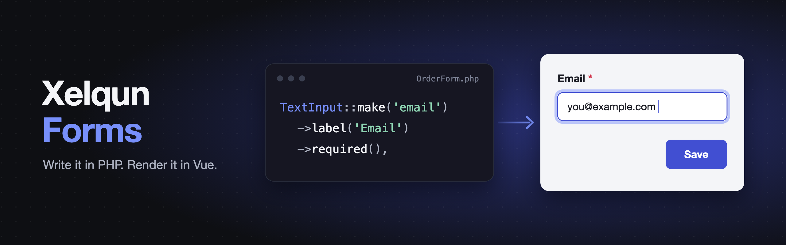

<p align="center">
    
</p>

<p align="center">
    <a href="https://packagist.org/packages/xelqun/forms"></a>
    <a href="https://www.npmjs.com/package/@xelqun/forms"></a>
    <a href="https://packagist.org/packages/xelqun/forms/stats"></a>
</p>

Describe a form in PHP and generic Vue components render it. Normal forms need no Vue at all.

> **Alpha:** the API will change. Requires Laravel 13, Inertia 3, Vue 3.5 and Tailwind 4.

## Installation

```bash
composer require xelqun/forms
php artisan xelqun-forms:install
```

## Documentation

Everything else is in the docs at **[xelqun.com/forms](https://xelqun.com/forms)**. You can also try the [demo](https://demo.xelqun.com).

## License

MIT
