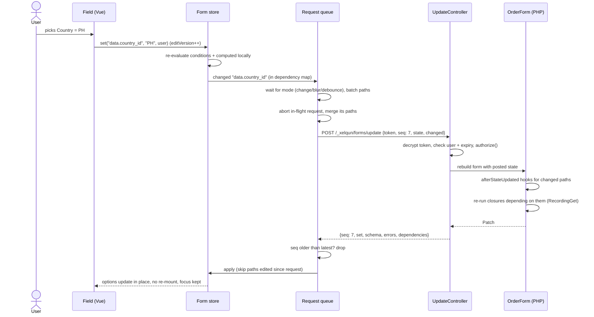
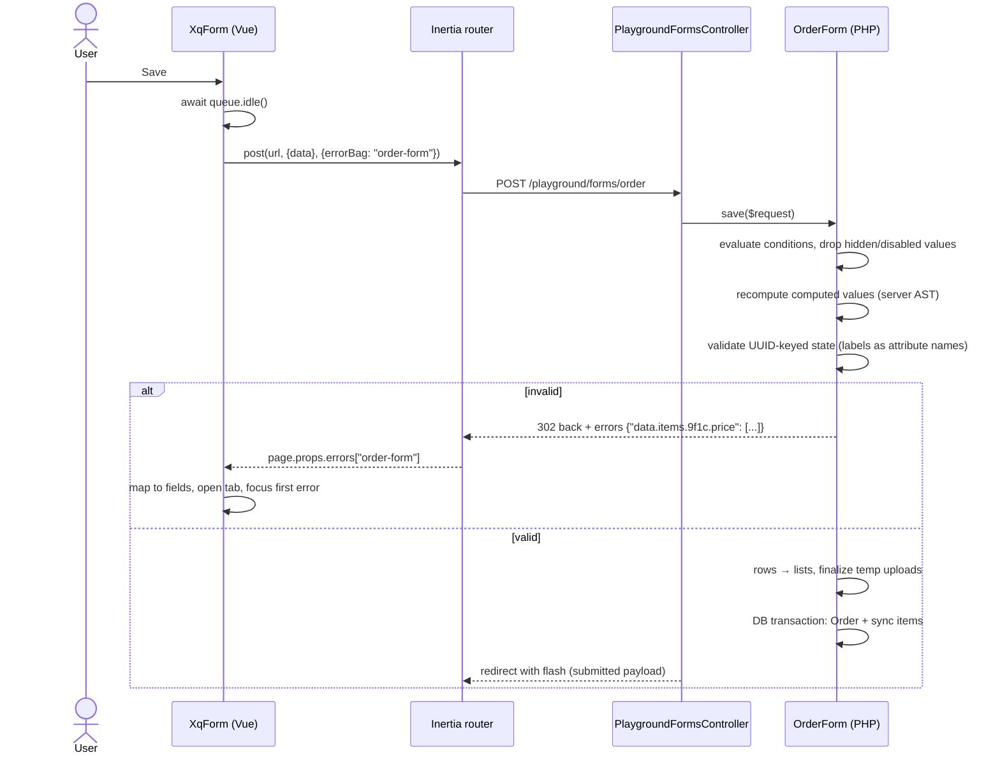

# Xelqun Forms: planning document

> Status: approved plan (2026-10-28), implemented through Milestone 9. Parity work continues in [`parity-plan.md`](parity-plan.md), through Milestone 13. See "Implementation status" at the end.

## Context

Xelqun is an open-source admin framework in the style of Filament, built for the VILT stack (Vue 3, Inertia, Laravel, Tailwind). The first package is **forms**. Developers define forms in PHP. The package turns them into a versioned JSON schema, and generic Vue components render that schema. Create/edit pages, filters, action modals and settings pages will all be built on it later, so the core has to be right: reactivity, server rules, security and design.

### What exploration found (it differs from the brief)

| Area | Finding | Effect |
|---|---|---|
| Playground app | Built from the **blank** Vue starter kit: Laravel 13.39, Inertia 3.5 (laravel) / 3.9 (vue3), Vue 3.5, Tailwind 4.3, PHP 8.4, Pest 5.3, Wayfinder. Only `Welcome.vue` and `routes/web.php` exist. **No auth, no sidebar, no shadcn-vue, no `components/ui`.** | You chose a simple public page with in-page navigation and no login. |
| Toolchain | Uses **Vite+** (`vp dev/build/test/check/pack`). `vp test` = Vitest 5 and `vp pack` builds libraries. npm 10 / Node 22 (`package-lock.json`; `pnpm-workspace.yaml` is just a leftover from the kit). `.npmrc` has `ignore-scripts=true`. | Vitest is already available and no new test runner is needed. |
| Git | The playground is **not a git repo**, and you chose to keep it that way. | No `.gitignore` or submodule work. Only `packages/forms` is versioned. |
| `199ocero/xelqun-forms` | Exists, **private and empty** (no commits). | Plan the first scaffold (below). |
| Names | `xelqun/forms` (Packagist) and `@xelqun/forms` (npm) are both **free**. `199ocero/xelqun` (SES app) will be removed or made private, so the name is OK. | Keep the proposed names. |
| `.ai/rules` | Does not exist. | Nothing to read. |

---

## 1. Questions and decisions

### Answered
1. **Playground shape:** a simple public page with no starter kit, login or app sidebar. Examples use in-page navigation.
2. **Name:** keep Xelqun (`xelqun/forms`, `@xelqun/forms`, `Xelqun\Forms`, `Xq*`, `--xq-*`, `/_xelqun/...`).
3. **Git:** the playground stays local only. `packages/forms` is its own repo. Nothing has to be ignored. *If you ever `git init` the playground, add `/packages/` to its `.gitignore`. That is better than a submodule for a solo developer, because a submodule needs two commits for every package change.*
4. **E2E tests:** Pest browser plugin (Playwright underneath, tests written in PHP).

### Decisions I'd change or sharpen (already built into the plan below)
1. **Live forms must be classes.** The update, upload and search endpoints have to *rebuild* the form from a token, so the form must be a class they can resolve (`OrderForm extends Form`). `Form::make([...])` stays for simple static forms. If an anonymous form uses closures, `live()` or uploads, serializing it throws a clear exception.
2. **Auto-live through dependency tracking.** If a server closure reads `country`, then `country` *is* a trigger. Without this, forgetting `->live()` would silently break forms. `->live()` then only picks the mode (`onBlur`, `debounce`), and fields with `afterStateUpdated` are live automatically. An explicit `->dependsOn([...])` covers branches the recorder never saw.
3. **Expressions are parsed once, in PHP.** `computed('qty * price')` is parsed by a PHP parser into a small AST, and the AST goes into the schema. Vue only *evaluates* the AST and ships no parser, so it stays small and safe. **On submit, the server recomputes every computed value with the same AST.** The client's totals are never trusted.
4. **Evaluator parity is enforced by shared test files.** One set of JSON test cases (`tests/fixtures/conformance/*.json`) runs in both Pest and Vitest. Conditions and expressions must give identical results in both languages.
5. **Patch `schema` is keyed partial nodes**, `{ "data.state": { "props": { "options": [...] } } }`, never a whole new tree. That is how components avoid re-mounting.
6. **Tokens are encrypted, not just signed** (Laravel `Crypt`). This hides class names and record keys, and the MAC stops tampering.
7. **Validate on UUID-keyed state, then convert rows to arrays.** Error keys (`data.items.<uuid>.price`) then match field paths directly. Validation attribute names are generated from labels ("Price (item 2)") so messages never show UUIDs.
8. **Component naming:** UI primitives are `XqInput`, `XqSelect…`, `XqButton` (copied from shadcn-vue). Field renderers are `XqTextInputField`, `XqSelectField`, and so on. This avoids a "Select field vs Select primitive" clash.
9. **Live requests use the package's own small `fetch` client** (with AbortController and the XSRF cookie), not Inertia's `useHttp`. This gives full control over aborting and ordering, and keeps the core free of Inertia. Inertia is only used to **submit**.
10. **One error bag per form** (Inertia `errorBag`), because the playground puts several forms on one page. This will be checked with `search-docs` in Milestone 2.

### Small defaults (tell me if you disagree)
MIT license · PHP `^8.4` · Laravel `^13` only, for now · icons from `lucide-vue-next` · dates through Reka UI + `@internationalized/date` · code highlighting in the playground through lazy-loaded Shiki (playground only).

---

## 2. Setup steps

All commands run from `/Users/jaocero/Projects/Personal/xelqun-playground`.

```bash
# 1. Clone the empty repo (git warns "cloned an empty repository", which is expected)
mkdir -p packages
git clone git@github.com:199ocero/xelqun-forms.git packages/forms
cd packages/forms && git checkout -b main

# 2. Scaffold the package (files listed in section 3), then install its own dev tools
composer install            # testbench, pest, pint, larastan for package tests
cd ../..                    # npm deps for the package are installed by the workspace (step 4)

# 3. PHP link: Composer path repository (symlinked by default)
composer config repositories.xelqun-forms '{"type":"path","url":"packages/forms","options":{"symlink":true}}'
composer require xelqun/forms:@dev     # @dev needed: playground has minimum-stability "stable"
ls -la vendor/xelqun                   # forms -> ../../packages/forms

# 4. JS link: npm workspace (recommended, see below)
npm pkg set 'workspaces[0]=packages/*'
npm pkg set 'dependencies.@xelqun/forms=*'
npm install
npm ls vue                             # must show ONE vue (deduped)
ls -la node_modules/@xelqun            # forms -> ../../packages/forms

# 5. First commit of the package
cd packages/forms && git add . && git commit -m "Initial package scaffold" && git push -u origin main
```

**Why an npm workspace (instead of a Vite alias or a `file:` dependency):**
- One `node_modules` at the playground root. The package's dependencies (reka-ui…) are installed and hoisted automatically, and there is **one copy of `vue`**. Two copies of Vue is the classic bug with linked Vue packages: reactivity and `provide/inject` silently break.
- Imports look exactly as they will for real users (`import { XqForm } from '@xelqun/forms'`). Moving to the published npm version later is a one-line change.
- A Vite alias would need the package's dependencies installed by hand in the host, and `tsconfig` paths too. A `file:` dependency tends to install a second `vue` inside `packages/forms/node_modules`.
- Safety net in `vite.config.ts`: `resolve: { dedupe: ['vue', '@inertiajs/vue3', 'reka-ui'] }`.

**Playground wiring after linking:**
- `resources/js/app.ts`: `withApp: (app) => app.use(createXelqunForms())`.
- `resources/css/app.css`: add `@import '@xelqun/forms/style.css';`. That file contains `@source "../js";` (relative to itself), so the host never has to know where the package lives. *Milestone 0 checks that this works through the symlink. Fallback: `@source '../../packages/forms/resources/js';` in `app.css`.*
- `vite.config.ts`: add `packages/**` to `lint.ignorePatterns` and `fmt.ignorePatterns`, because the package has its own lint and format config.
- Pest browser plugin (Milestone 2): `composer require pestphp/pest-plugin-browser --dev` (the version that matches Pest 5), `npm install -D playwright`, `npx playwright install chromium`.

> These are new dependencies for the playground: the `xelqun/forms` path repo, the npm workspace, the Pest browser plugin, Playwright and Shiki. Approving this plan approves them.

---

## 3. Package structure

**Recommendation: one repo, two manifests.** `xelqun-forms` holds both `composer.json` (`xelqun/forms`) and `package.json` (`@xelqun/forms`), and both are released from the same tag. Ziggy does the same. Users run `composer require xelqun/forms && php artisan xelqun-forms:install`, and the installer adds the matching npm package and wires up the app.

| Option | Pros | Cons |
|---|---|---|
| **npm package from the same repo (chosen)** | Normal JS tooling: dependencies resolve, TypeScript types work, works with any package manager, one Vue copy | Two installs, so PHP and JS versions can drift. The installer pins the npm version to the PHP package, and the schema version handshake (section 4) catches any later drift. |
| Vite path into `vendor/xelqun/forms` | One install, versions always match | Host installs the package's JS dependencies by hand, awkward TypeScript paths, unusual for JS developers, a later Vite plugin would be needed anyway |

**MVP ships TypeScript and Vue source** (no build step). The host's Vite compiles it, Tailwind scans it, and an "eject" is a file copy. Before 1.0, decide whether to precompile with `vp pack`. A prototype showed it can drop the npm package, but `reka-ui` can't simply be bundled: a second copy breaks popovers inside a host's own Reka dialog (Escape closes the dialog, and options can't be clicked because they inherit `pointer-events: none`). It would need a second build that uses the host's `reka-ui`, and about 53 kB of calendar code moved into the main bundle.

```
packages/forms/
├── composer.json  package.json  tsconfig.json  vite.config.ts (vitest)  phpunit.xml  pint.json  phpstan.neon
├── .github/workflows/ci.yml       # pest + pint + larastan + vp test + vue-tsc
├── config/xelqun-forms.php        # route prefix, middleware, temp disk, upload ttl, token ttl
├── routes/xelqun-forms.php        # /_xelqun/forms/{update,upload,search}
├── src/                           # namespace Xelqun\Forms\
│   ├── FormsServiceProvider.php
│   ├── Form.php                   # base class + static make([...]) for anonymous forms
│   ├── Components/                # Component (base), Field (base), TextInput, Textarea, Select,
│   │                              # Checkbox, Toggle, Radio, DatePicker, FileUpload, Repeater,
│   │                              # Hidden, CustomField
│   ├── Layouts/                   # Section, Grid, Fieldset, Tabs, Tab
│   ├── Concerns/                  # HasLabel, HasRules, HasConditions, CanBeLive, HasOptions, HasColumnSpan…
│   ├── Conditions/                # When (builder), Condition (AST node), ConditionEvaluator
│   ├── Expressions/               # Lexer, Parser, Node types, ExpressionEvaluator
│   ├── State/                     # Get, Set, RecordingGet, StatePath, StateBag, DependencyMap, RowKeys
│   ├── Schema/                    # SchemaSerializer, SchemaVersion, NodeKey
│   ├── Live/                      # UpdateRequest, UpdateProcessor, Patch
│   ├── Security/                  # FormToken (value object), FormTokenEncrypter
│   ├── Validation/                # RuleCollector, AttributeNames, SubmittedData (dehydrate)
│   ├── Uploads/                   # TemporaryUpload, TemporaryUploadStore, PruneTemporaryUploadsCommand
│   ├── Eloquent/                  # ModelHydrator (fill), ModelPersister (save), BelongsToHandler, HasManyHandler
│   ├── Http/Controllers/          # UpdateController, UploadController, SearchController
│   └── Exceptions/
├── resources/
│   ├── css/xelqun.css             # @source "../js"; --xq-* tokens; .dark overrides; @theme inline mappings
│   └── js/
│       ├── index.ts               # public API
│       ├── plugin.ts              # createXelqunForms({ components })
│       ├── schema/types.ts        # TS mirror of the JSON contract
│       ├── core/                  # store.ts, paths.ts, conditions.ts, expressions.ts, patch.ts,
│       │                          # queue.ts, http.ts, submit.ts, rows.ts
│       ├── composables/           # useXqForm.ts, useField.ts, useNode.ts
│       ├── registry.ts
│       ├── components/
│       │   ├── XqForm.vue  XqNode.vue  XqFieldWrapper.vue (label/hint/error)
│       │   ├── fields/            # XqTextInputField.vue … XqRepeaterField.vue, XqFileUploadField.vue
│       │   └── layouts/           # XqSection.vue XqGrid.vue XqFieldset.vue XqTabs.vue
│       └── ui/                    # copied shadcn-vue primitives built on Reka UI, renamed Xq*, tokens only
└── tests/
    ├── Pest.php  TestCase.php (Orchestra Testbench)
    ├── Unit/  Feature/  .pest/snapshots/
    ├── fixtures/conformance/      # conditions.json, expressions.json, shared with Vitest
    └── js/                        # *.test.ts (Vitest + @vue/test-utils + happy-dom)
```

- **composer.json:** `require` php ^8.4, `illuminate/{support,http,validation,database,filesystem}` ^13, `inertiajs/inertia-laravel` ^3. `require-dev` Testbench (Laravel 13 line), Pest 5, pest-plugin-laravel, Pint, Larastan. PSR-4 `Xelqun\\Forms\\` → `src/`. Auto-discovered provider.
- **package.json:** `"exports": { ".": "./resources/js/index.ts", "./style.css": "./resources/css/xelqun.css" }`. Peer dependencies `vue ^3.5`, `@inertiajs/vue3 ^3`. Dependencies `reka-ui`, `clsx`, `tailwind-merge`, `class-variance-authority`, `@internationalized/date`, `lucide-vue-next`. Dev dependencies `vitest`, `@vue/test-utils`, `happy-dom`, `vue-tsc`, `typescript`.
- **Theming:** components use only token utilities (`bg-xq-surface`, `text-xq-muted`, `ring-xq-ring`…), which `@theme inline { --color-xq-surface: var(--xq-surface) … }` maps to `--xq-*` variables. Dark mode swaps variables under `.dark, [data-xq-theme=dark]`. There are no `dark:` variants in components, so the host's dark mode setup does not matter. Because these names never collide with shadcn's `--primary` and similar, they can live inside any shadcn-vue app.

---

## 4. The JSON schema contract (v1 draft)

```jsonc
// Inertia prop: what OrderForm::make($order)->toSchema() returns
{
  "$xq": 1,                              // schema MAJOR version. JS supports [1]. Mismatch → dev error box
  "pkg": "0.1.0",                        // PHP package version, for diagnostics
  "id": "order-form",                    // also the Inertia errorBag name
  "token": "eyJpdiI6…",                  // encrypted FormToken (null for static forms)
  "endpoints": { "update": "/_xelqun/forms/update", "upload": "…/upload", "search": "…/search" },
  "state": { "data": { "type": "individual", "country": null, "items": { "9f1c…": { "qty": 1, "price": 0, "subtotal": 0 } } } },
  "dependencies": { "data.country": ["data.state"] },   // trigger path → nodes the server must re-resolve
  "components": [ /* nodes */ ]
}
```

**Node (field or layout):**
```jsonc
{
  "key": "data.state",                   // unique and stable. Vue :key and patch target
  "type": "select",                      // registry key
  "path": "data.state",                  // state path (null for layouts)
  "label": "State", "hint": null, "placeholder": null,
  "required": false, "disabled": false,  // static, resolved on the server
  "rules": {                             // client conditions (optional)
    "visible":  { "op": "filled", "path": "data.country" },
    "required": null, "disabled": null
  },
  "computed": null,                      // expression AST (see below)
  "live": { "mode": "change" | "blur" | "debounce", "ms": 400 } | null,
  "span": { "default": 1, "md": 2 },
  "props": { "options": [{ "value": 12, "label": "Cebu" }], "searchable": false },  // type-specific
  "children": []                         // layouts only
}
```
- Fields hidden or forbidden by the server are **not serialized at all**.
- **Repeater** node: `props.template` (child nodes with row-relative paths like `.price`), `props.orderable`, `props.minItems`/`maxItems`, `props.addLabel`. Row state lives in an object keyed by UUID. Per-row overrides arrive as patches keyed by the full key (`data.items.9f1c….product`).
- **Empty repeater must serialize as `{}`**, not `[]`. In PHP, `json_encode([])` gives `[]`, a classic bug. The serializer casts row bags to objects.

**Condition AST:** `{ op, path?, value?, args? }`
`eq, neq, in, notIn, gt, gte, lt, lte, filled, blank, and, or, not`.
**Path resolution (same for `When`, `Get` and expressions):** a bare name resolves against the field's container, which is the form root or the current repeater row. `$.name` forces the form root. `data` has no special meaning here, so a field can be named `data`. The serializer turns both into absolute paths (rows use the `{row}` placeholder in templates).

**Expression AST:** `{ "src": "qty * price", "ast": { "op": "*", "args": [{ "ref": "qty" }, { "ref": "price" }] } }`.
Supported: numbers, strings, refs, `+ - * / %`, comparisons, `&& || !`, parentheses, functions `sum`, `count`, `min`, `max`, `avg`, `round(x, d)`, `abs`, and wildcards `items.*.subtotal`. Null or empty counts as 0 in arithmetic, and dividing by 0 gives 0. Both evaluators follow these rules exactly, and the conformance files prove it.

**Update request / patch:**
```jsonc
// POST /_xelqun/forms/update
{ "token": "…", "seq": 7, "state": { "data": { … } }, "changed": ["data.country"] }
// response
{
  "$xq": 1, "seq": 7,
  "set":    { "data.state": null },                                  // values the server changed
  "schema": { "data.state": { "props": { "options": [ … ] } } },     // partial nodes, deep-merged by key
  "remove": [], "add": [],                                           // rare: server-side visibility changes
  "errors": { "data.state": ["…"] },                                 // optional live validation
  "dependencies": { "data.country": ["data.state"] }                 // refreshed map
}
```

**Versioning rules:** adding an optional key = no bump. Renaming or removing a key, or changing what it means = `$xq` + 1. The JS package keeps a `SUPPORTED_SCHEMA = [1]` list. On a mismatch it shows a readable error in dev and a console error in prod.

---

## 5. The PHP API

```php
final class OrderForm extends Form
{
    public function schema(): array
    {
        return [
            Radio::make('type')->options(['individual' => 'Individual', 'business' => 'Business'])->default('individual'),
            Section::make('Business details')->visibleWhen(When::eq('type', 'business'))->schema([
                TextInput::make('company')->requiredWhen(When::eq('type', 'business')),
            ]),
            Select::make('country_id')->relationship('country', 'name')->live(),
            Select::make('state_id')->options(fn (Get $get) => State::where('country_id', $get('country_id'))->pluck('name', 'id'))
                ->afterStateUpdated(fn (Set $set) => $set('city', null)),
            Repeater::make('items')->relationship('items')->schema([
                TextInput::make('qty')->numeric()->minValue(1),
                TextInput::make('price')->numeric(),
                TextInput::make('subtotal')->computed('qty * price')->disabled(),
                FileUpload::make('attachment')->disk('public')->directory('order-items')->maxSize(2048),
            ]),
            TextInput::make('total')->computed('sum(items.*.subtotal)')->disabled(),
        ];
    }

    public function authorize(?Authenticatable $user, ?Model $record): bool { return true; }
    public function model(): string { return Order::class; }
}

// controller
Inertia::render('playground/Forms', ['form' => OrderForm::make($order)->toSchema()]);
$data = OrderForm::make($order)->validate($request);   // clean, dehydrated array
OrderForm::make($order)->save($request);                // validate + fill + relationships + finalize uploads
```

| Class | Job |
|---|---|
| `Form` | Base class. `make(?Model $record, array $context = [])`, `schema()`, `authorize()`, `model()`, `toSchema()`, `validate()`, `save()`, `fill()`. Static `Form::make([...])` creates an anonymous, non-live form. |
| `Components\Component` | Base for all nodes: key, `visible()`/`hidden()` (bool or closure, server-side), `visibleWhen()`, `columnSpan()`, `toNode()`. |
| `Components\Field` | Adds name/path, label, hint, default, `required()`, `rules()`, `requiredWhen()`, `disabled()`, `disabledWhen()`, `live()`, `afterStateUpdated()`, `dependsOn()`, `dehydrated()`, `computed()`. M12 adds `readOnly()`, `disabledOn()`, `saved()`, `formatStateUsing()`, `dehydrateStateUsing()`, `afterStateHydrated()`, `state()`, `autofocus()`, `hiddenLabel()` and `inlineLabel()`. |
| Fields | `TextInput` (`email()`, `password()`, `numeric()`, `prefix/suffix`), `Textarea`, `Select` (`options()`, `searchable()`, `getSearchResultsUsing()`, `relationship()`, `multiple()`), `Checkbox`, `Toggle`, `Radio`, `DatePicker`, `FileUpload`, `Repeater`, `Hidden`, `CustomField` (`component('rating')`). |
| Layouts | `Section`, `Grid` (`columns()`), `Fieldset`, `Tabs` + `Tab`. |
| `Conditions\When` | `eq`, `neq`, `in`, `notIn`, `gt`, `gte`, `lt`, `lte`, `filled`, `blank`, `and`, `or`, `not` → `Condition` (`toArray()`, `evaluate(StateBag)`). |
| `Expressions\Parser` / `ExpressionEvaluator` | Parse the string to an AST once at schema build time. Evaluate on submit. |
| `State\Get` / `Set` / `RecordingGet` | Closure helpers with container-relative paths. `RecordingGet` logs every path it reads, which builds the `DependencyMap`. |
| `Security\FormToken` / `FormTokenEncrypter` | `{form class, record key, user id, context, issued_at}` → `Crypt::encryptString`. On decrypt it checks that the class extends `Form`, the user matches, and the token has not expired. |
| `Live\UpdateProcessor` | Rebuilds the form with the posted state, runs hooks for the changed paths, re-runs dependent closures, and builds a `Patch`. |
| `Validation\SubmittedData` | Evaluates conditions, drops hidden/disabled/non-dehydrated values, recomputes computed values, validates on UUID state, then converts rows to lists and resolves upload tokens. |
| `Uploads\*` | The temp store puts files on a configurable disk under a random id and stores metadata (session, field key, ttl). The prune command deletes expired files. |
| `Eloquent\*` | `fill()` reads the record (BelongsTo → foreign key, HasMany → rows keyed by new UUIDs and holding the record id). `save()` runs in a transaction and syncs HasMany (create, update, delete). |
| Controllers | `UpdateController`, `UploadController`, `SearchController`. All decrypt the token, call `authorize()`, rebuild the form and validate their own input. Routes use `web` middleware plus `throttle`. |

---

## 6. The Vue/TS API

```ts
// app.ts
app.use(createXelqunForms({ components: { rating: () => import('./fields/RatingField.vue') } }))

// page
const form = useXqForm(props.form)            // or <XqForm :form="props.form" :action="store.url()" />
form.state.data.items                          // reactive
await form.submit(store.url(), { method: 'post' })
```

| Piece | File | Behavior |
|---|---|---|
| **Form store** | `core/store.ts` | `createFormStore(schema)` creates reactive `state`, `errors`, a `nodes` map (key → reactive node), `editVersion` per path, and `get`/`set(path, value, source)` where source is `user`, `server` or `computed`. Converts between paths and nested objects. |
| **`useField(path)`** | `composables/useField.ts` | Returns `{ value (writable computed), error, node, visible, required, disabled, onBlur }`. A user write bumps `editVersion` and notifies the queue. Used by every field component, including custom ones. |
| **Condition evaluator** | `core/conditions.ts` | `evaluate(ast, get)` is pure. Each node's `visible`/`required`/`disabled` is a Vue `computed`, so Vue tracks dependencies itself and there is no server call. |
| **Expression evaluator** | `core/expressions.ts` | `evaluate(ast, get)` is pure and has no parser. Each computed node gets a `watchEffect` that writes the result into state with source `computed`, so the JSON viewer and submit see it. |
| **Patch applier** | `core/patch.ts` | Drops a patch if `seq < lastAppliedSeq`. `set` skips any path whose `editVersion` changed after the request snapshot. `schema` deep-merges into the existing reactive node objects (never replaced), so there is no re-mount and focus and cursor stay. Handles `add`/`remove`, replaces the dependency map, and merges errors. |
| **Component registry** | `registry.ts` | `type → component` (sync or async, so heavy fields are code-split). Built-in defaults plus user overrides. An unknown type renders a dev warning box. |
| **Request queue** | `core/queue.ts` | Collects changed paths that are live or in the dependency map. Flush triggers are `change` (next tick), `blur`, or `debounce` (one timer, batched). On flush it aborts any in-flight request and merges the aborted request's paths into the new one, then sends `seq = ++seq` with a state snapshot. `form.submit()` awaits `queue.idle()`. Exposes a request log for the playground's Network panel. |
| **HTTP client** | `core/http.ts` | `fetch` with the `X-XSRF-TOKEN` cookie header, JSON, an AbortSignal, and errors mapped (419 → token expired, so the page reloads). |
| **Submit** | `core/submit.ts` | `router.visit(url, { method, data: { data: state.data }, errorBag: form.id, preserveScroll: true })`. Watches `page.props.errors[form.id]` and maps them into the store, switches to the tab with the first error, and focuses it. |

---

## 7. The playground page plan

- **Route** (`routes/web.php`): `Route::get('/playground/forms/{example?}', [PlaygroundFormsController::class, 'show'])->name('playground.forms')` and `Route::post('/playground/forms/{example}', [..., 'submit'])->name('playground.forms.submit')`. Public, with no login. `{example}` is a slug, so each example has its own URL and only the active form is built. Add a link from `Welcome.vue`.
- **Controller** `app/Http/Controllers/PlaygroundFormsController.php`: `show` renders `playground/Forms` with `examples` (slug, title, description), `active`, `form` (`->toSchema()`), `source` (the PHP file contents of the example class, read through `ReflectionClass::getFileName()`), and flashed `submitted` data. `submit` validates (or saves, for the order form), then redirects back with the cleaned payload flashed.
- **Example classes** (`app/Playground/Forms/`): an `Example` enum or registry mapping slugs to `BasicFieldsForm`, `ConditionalFieldsForm`, `DependentFieldsForm`, `RepeaterTotalsForm`, `FileUploadsForm`, `ValidationErrorsForm` and `TrickyOrderForm`.
- **Demo data:** migrations, models, factories and seeders for `countries`, `states`, `orders` (type, customer_name, company, vat_number, country_id, state_id, total) and `order_items` (order_id, sort, product, qty, price, subtotal, attachment). The order example can create and edit (`?order=ID`).
- **Inertia page** `resources/js/pages/playground/Forms.vue` with a persistent `layouts/PlaygroundLayout.vue` (header with the Xelqun wordmark, a light/dark toggle and a GitHub link). Two columns on wide screens:
  - left: the example nav (vertical list on desktop, scrolling pills on mobile) and the rendered form card
  - right, an **Inspector** with tabs: **State** (live JSON, with changed paths flashing), **Errors**, **Network** (the queue's request log: seq, changed paths, ms, patch body), **PHP** (Shiki-highlighted source), and **Submitted** (the last cleaned server payload)
- The playground builds its UI from the package's `Xq*` primitives (dogfooding). Supporting components go in `resources/js/components/playground/` (`ExampleNav`, `InspectorPanel`, `JsonView`, `CodeView`, `ThemeToggle`).
- Wayfinder: the page uses `@/routes/playground` helpers for the submit URLs.

---

## 8. Sequence diagrams

**Live update (country → state)**


**Submit**


---

## 9. Testing strategy

| Layer | Where | What |
|---|---|---|
| **Pest unit tests** (package) | `packages/forms/tests/Unit` | `When` → AST, the condition evaluator, the expression lexer, parser and evaluator, `StatePath` resolution (relative, `$.`, wildcards), `RecordingGet`, token encrypt/decrypt/tamper/expiry, repeater row keys, and the empty repeater serializing as `{}`. |
| **Schema snapshots** (package) | `tests/Feature/Schema` | One fixture form per field and layout → `expect($form->toSchema())->toMatchSnapshot()`. A snapshot diff is a contract change, so decide whether `$xq` needs a bump. |
| **Shared conformance files** | `tests/fixtures/conformance/*.json` | `{ ast, state, expected }` cases. Pest uses a dataset and Vitest uses `describe.each` over the same files. |
| **Pest feature tests** (package, Testbench) | `tests/Feature/Http` | Update endpoint: a dependent closure re-runs and an unrelated one doesn't, wrong user → 403, tampered token → 403, expired token → 419-style error, `authorize()` false → 403. Upload: mime and size rules, temp file stored and pruned. `validate()`: hidden values dropped, computed values recomputed, nested errors keyed by UUID with friendly attribute names. Eloquent fill and save with BelongsTo and HasMany. |
| **Vitest** (package) | `tests/js` | Store and `useField`. The patch applier keeps a focused `<input>` (same element and `document.activeElement` after a patch). The queue with fake timers and a fake fetch: batching, abort and merge, stale seq dropped, edited paths not overwritten. The registry. Rendering each snapshot fixture without errors. |
| **Playground feature tests** | `tests/Feature/PlaygroundFormsTest.php` | Each example slug renders `playground/Forms` with the expected props (`assertInertia`), and submit redirects with errors or flash. |
| **Pest browser tests** | `tests/Browser/TrickyOrderFormTest.php` (+ one per example) | Visit `/playground/forms/order`. Pick a country and states appear. Choose type business and the section appears. Add 2 rows, type qty and price, and the subtotals and grand total update. Upload a file in row 2. Submit with a bad price and the error appears under row 2's price. `assertNoJavascriptErrors()`. |

Commands: package `vendor/bin/pest`, `vp test`, `vendor/bin/pint`. Playground `php artisan test --compact tests/Browser`. Feature and browser tests rebuild `public/build` first if a front-end source file is newer than it (see `rebuildAssetsWhenStale()` in the playground's `tests/Pest.php`).

---

## 10. Milestones

Each one ends with something visible at `/playground/forms`.

| # | Milestone | Done when you can see… |
|---|---|---|
| **0** | **Package setup and linking.** Clone, scaffold both manifests, provider, `xelqun.css` tokens, one `XqButton` primitive, Composer path repo, npm workspace, Vite `dedupe`, CI skeleton, first push. | A temporary route renders `XqButton` from the package with `--xq` colors, a PHP value comes from the package provider, and editing the package's `.vue` file hot-reloads. `npm ls vue` shows one copy. |
| **1** | **Playground page shell.** Route, controller, `Example` registry with 7 empty example classes, `PlaygroundLayout`, example nav, Inspector (State/PHP tabs), theme toggle, demo migrations and seeders. | The page with all 7 tabs, highlighted PHP source for each, and working light/dark. |
| **2** | **Schema and TextInput renderer.** `Form`, `Component`, `Field`, `TextInput`, `Textarea`, `Section`, `SchemaSerializer` (`$xq: 1`), `XqForm`, `XqNode`, registry, store, `useField`, submit through Inertia with an error bag, server validation (flat paths). First snapshot tests and the first browser smoke test. | "Basic fields" renders text inputs, the State panel updates as you type, and submitting shows server errors under fields and the cleaned payload. |
| **3** | **Remaining fields and layouts** (can be interleaved): Select (static), Checkbox, Toggle, Radio, DatePicker, Hidden, Grid, Fieldset, Tabs. | "Basic fields" shows every MVP field type in a nice layout. |
| **4** | **Conditions.** `When`, the PHP evaluator, the TS evaluator, the conformance files, server-side dropping of hidden values, `requiredWhen` in validation. | "Conditional fields": sections and fields appear and disappear instantly, and submitting while hidden shows the value dropped in the Submitted panel. |
| **5** | **Live protocol.** Token, `/update`, `Get`/`Set`, `RecordingGet` + dependency map, `afterStateUpdated`, queue, patch applier, Network panel, plus the searchable/async Select search endpoint. | "Live dependent fields": country → states with requests visible in Network, fast typing produces one request, and focus is never lost. |
| **6** | **Repeater and computed values.** UUID rows (add, remove, reorder), template nodes, expression parser and evaluators, `sum()`, server recompute, nested errors with friendly names. | "Repeater with totals" with live subtotal and grand total, and "Validation errors" with errors on `items.<uuid>.price`. |
| **7** | **File upload.** Temp upload endpoint, temp store, finalize on save, prune command, FileUpload inside a repeater row. | "File uploads" with progress, preview, remove, and a file finalized after submit. |
| **8** | **Eloquent and the tricky order form.** `fill`/`save`, `relationship()` on Select (BelongsTo) and Repeater (HasMany), the full `TrickyOrderForm`, and the browser test from section 9. | All 5 proof points pass, by hand and in the browser test. Saving, then reopening `?order=ID`, refills everything. |
| **9** | **Polish for the public demo.** Design pass, a11y (labels, aria-invalid, focus rings), empty and loading states, mobile layout, lazy heavy fields. "Eject" command noted for later. | A demo page you would share. |

---

## 11. Risks and unknowns

| Risk | Why it matters | Reduced in |
|---|---|---|
| Tailwind doesn't scan package classes through the symlink, or `@source` in an imported CSS file misbehaves | Unstyled components | **M0** (fallback: explicit `@source` in host) |
| Two copies of Vue from the linked package | Reactivity and `inject` silently break | **M0** (workspace hoisting, `dedupe`, `npm ls vue`) |
| Host `vue-tsc` type-checks package source and trips over strictness differences | Red CI in user apps | **M0** (match strict settings, run `vue-tsc` in both) |
| Losing focus or cursor when a patch arrives | The biggest "feels broken" bug | **M5** (Vitest focus test, keyed in-place merge) + **M8** browser test |
| Race conditions: stale responses, overwriting the user's typing | Lost input | **M5** (seq, abort + merge, `editVersion` guard, fake-timer tests) |
| The dependency recorder misses closure branches | Fields don't refresh | **M5** (re-record on every server run, send a fresh map, `dependsOn()` escape hatch) |
| PHP and JS evaluators disagree (floats, null, empty string) | Client shows a different total than the server saves | **M4/M6** (shared conformance files, server recompute is the source of truth) |
| Data leaks: a hidden field's options or default values sent to the browser | Security | **M2/M5** (server-hidden nodes never serialized, tests assert their absence) |
| Token replay or tampering, or a forged form class | Security | **M5** (encrypted, user-bound, ttl, `instanceof Form` check, `authorize()` on every call, tests) |
| `json_encode([])` → `[]` for empty repeaters, and UUID keys in validation messages | Subtle client bugs, ugly errors | **M6** (object casting, attribute-name map, tests) |
| Large option lists bloat the schema | Slow pages | **M5** (searchable Select endpoint, `preload` limits) |
| Several forms on one page mixing errors | Wrong errors shown | **M2** (error bag per form id) |
| The public demo's upload endpoint gets abused | Disk filling up | **M7** (throttle, size limits, short TTL, prune via scheduler) |
| Inertia v3 and Vite+ details (error bags, persistent layouts, `vp` quirks) | Rework | Check with `search-docs` when each is first used (M1/M2) |
| Scope creep for one part-time developer | Never shipping | Each milestone is small and visible; M9 is optional polish |

---

## Implementation status (2026-11-05)

Milestones 0–9 are built and tested. Milestone 9 added failure and loading feedback for live updates, screen reader and keyboard support across every field type, reduced motion, and WCAG AA text contrast. It has not been checked with a real screen reader, on real phones, or in Safari and Firefox.

| Proof point | Covered by |
|---|---|
| Country → state, states loaded from the server | `tests/Browser/TrickyOrderFormTest.php`, package `LiveUpdateTest` |
| Section shown only for business customers | browser test, package `ValidationTest` (hidden values dropped) |
| Repeater with live `qty × price` subtotal and grand total | browser tests, Vitest `store.test.ts`, server recompute in `ValidationTest` |
| File upload inside a repeater row | browser test, package `UploadTest` |
| Server errors on the correct nested field | browser tests (`Price (Item 2)`), package `ValidationTest` |

**Test counts:** package Pest 477, package Vitest 219, playground feature and browser 44.

### Milestone 10: foundations

The first milestone of [`parity-plan.md`](parity-plan.md). It changes no public field API.

- **One preparation step.** `FormValidator::prepare()` now runs for update, search and validate, so the values that decide anything are server values. Static `hidden()` and `disabled()` are locked before any closure runs. The rest repeats from the posted data until the locks settle, so a closure can safely read a locked field declared after it. After five passes locks can only be added, so it always ends and a long chain can't stop partway.
- **Hidden values stay on the server.** A field hidden with `hidden()` sends no value to the browser, in the page state, in `newRow` or in a patch from a hook. Closures still read its server value. When a closure reveals the field, the patch brings the value along. `visibleWhen()` is different: the browser evaluates it, so it needs the value, and a field the user switched off simply stops counting.
- **Uploads survive a failed save.** `UploadBatch` copies files before the transaction and deletes temporary files only after commit, on the connection the record is saved on. A real rollback deletes the copies, including one from a transaction around `save()`, and the tokens stay valid. An exception after the commit leaves the files alone. Each save gets its own copy, so a failed save can't delete another save's file, and a disk that refuses a file fails the save.
- **Nesting-safe rows.** Each repeater level has its own placeholder (`{row}`, `{row:1}`), sent as `props.rowPlaceholder`. Starter rows are keyed `row-{n}`, and rows stored on a record `stored-{hash}` from their content, so a rebuilt form recognises them. If another user changed or removed a stored or related row, submitting it fails with a validation error asking the user to reload, instead of losing its locked values.
- **One field per path.** Two fields on one state path now throw a `FormDefinitionException`, because state, validation, patches and the browser all address a field by its path. To vary a field, use closures on one field. Supporting duplicates would need a change to how nodes are keyed.
- **Smaller fixes.** `visible(Closure)` reads the row it belongs to, closures no longer run before `authorize()`, `orderable(false)` is enforced on the server, `Select` refuses `MorphTo`, a locked `NULL` column stays `NULL`, retrying `save()` on the same form after a rollback writes the record, and the first error gets focus, including in a closed tab and after rows move.

Limits to keep in mind:

- A `computed()` expression runs in the browser too, and can't read a `hidden()` value there. The browser then shows a different total from the one the server saves. If a total depends on a hidden value, calculate it in a server closure.
- A field locked by a closure can only be found by running closures, so on the first pass `hidden()` and `disabled()` closures may read a posted value that later gets locked. Only the final pass decides anything, but these closures must not act on what they read. Static `hidden()` and `disabled()` have no such window.
- `validate()` makes uploads final as soon as it returns. Callers who write the data themselves should wrap it in `DB::transaction()`; `save()` does this for them.
- A value a hook writes into a disabled or hidden field lasts one request. Later requests read the server's value, because the server can't tell the browser echoing it from tampering. M12 kept this. To save a locked value that follows other fields, use `disabled()->saved()->dehydrateStateUsing()`, which derives it on the server at save time.
- Stale rows are only detected for rows the browser posts. A row another user added is not posted, so saving still replaces the list without it.
- `hidden()` and `disabled()` closures run on every update and search, usually twice when a closure locks a field.

### Milestone 11: plugin foundation

The package can now be extended from outside. The proof is `tests/Fixtures/ExamplePlugin`, a separate package with a namespaced type, search, uploads, its own saving, a validation rule and a translation. The playground installs it with `xelqun-forms:plugin`, and a browser test uses it, with no change to package source. Authors start from [`plugins.md`](plugins.md).

- **Contracts.** `HasSearchResults`, `AcceptsUploads`, `ContainsRows`, `PersistsItself` and `NeedsServer` replace every check on a concrete field. Built-in fields use them too, and two tests fail if such a check comes back, in PHP or in the client core.
- **`Repeater` is a client of its own contracts.** Its HasMany sync moved from `ModelPersister` to `Repeater::persist()`. A plugin field inside a relationship row gets `persist()` with the row's model. A repeater nested in such a row doesn't save its rows until M16.
- **Uploads fail closed.** `HandlesUploads` holds the rules `FileUpload` used to own, and `UploadBatch` re-checks a token's scope before storing it, so a plugin that leaves the rules out still can't copy another field's upload.
- **The client reads `containsRows`** on a node instead of its type. It is a new optional key, so `$xq` stays 1.
- **`createXelqunForms({ plugins })`** registers plugins. A collision throws in development and is logged in production, where the first registration stays. `replaces: [...]` is the explicit flag from decision 18, and it only works on built-in fields. `setup({ app })` gets no access to the registry, so it can't get around these rules.
- **`xelqun-forms:plugin`** reads `extra.xelqun` and validates it, because those values reach a shell command and the app's source. It ignores comments, and refuses spread options or a comment inside the call rather than guess. It shares its patching with `xelqun-forms:install`.
- **`make:xelqun-field`** creates a PHP class and a Vue component. The Vue stubs are real files that Vitest mounts, so a broken stub fails CI.
- **Also added:** `configureUsing()`, `Macroable` on every component, translations under `xelqun-forms::messages`, `@api` tags, `InteractsWithForms` and `@xelqun/forms/testing`.

Changes that can break existing code, for the release notes:

- `Repeater::isSafeRowKey()` moved to `StatePath::isSafeRowKey()`.
- `Repeater::discardUnsafeRows()` and `restoreRowOrder()` are private. Call `normalizePostedRows()`.
- A hand-built node with rows needs `containsRows: true`.
- Package messages moved to translation keys, so a JSON translation of the old English text no longer applies.

Limits to keep in mind:

- The plugin starter is stubs and the example plugin. A public starter repo needs your go-ahead, because it's a new public GitHub repo.
- `make:xelqun-field` writes into `app/` and `resources/js/forms`, so a plugin author moves the files into the plugin.
- Plugin limits are listed at the end of [`plugins.md`](plugins.md). The main ones: one file per `AcceptsUploads` field until M17, and no saving of nested rows until M16.

### Milestone 12: state and field basics

One form can now behave differently on create and edit. The proof is the order example in the playground: after saving, it shows a read-only order number, locks the customer type and drops the confirmation toggle. A feature test posts tampered values to that edit and they change nothing.

- **Operation.** `Form::getOperation()` returns `create` or `edit` from the record, or the context's `operation` (`Form::make($order, ['operation' => 'view'])`). It is fixed in the constructor, so saving a new record leaves it on `create`, and it comes back from the encrypted token, never from the request. Closures can ask for `$operation`.
- **`hiddenOn()`, `visibleOn()` and `disabledOn()` resolve when the form mounts.** They become plain `true` or `false`, so they get the static guarantees of `hidden()` and `disabled()`: locked before any closure runs, with no stub sent to the browser. As in Filament, each replaces `hidden()`, `visible()` or `disabled()`, whichever came last.
- **`readOnly()` is a server guarantee.** The posted value is dropped before closures run, rules are skipped, and search, upload and hooks are refused. Text inputs and textareas use the `readonly` attribute. Every other control renders as disabled, because it has no read-only mode, and this includes plugin fields that use `useField`.
- **State hooks.** `afterStateHydrated()` runs after the whole form is filled, so it can read any field, including inside rows. `formatStateUsing()` is a shorthand for it, and `state()` sets the value. `dehydrateStateUsing()` runs after the field's own `dehydrateState()`, so it receives the cast value.
- **Flags can turn off live.** The browser merges patches and never removes a key, so a field that could be read-only sends `readOnly` either way, and `extraAttributes` is replaced whole.
- **`saved()` is `dehydrated()`.** Filament 5 documents it as the same idea, so it delegates, and both now take a closure. `dehydrated()` stays. Unlike Filament, `disabled()->saved()` writes the server's value, so a browser can't change it.
- **Display options.** `extraAttributes()` goes on the outer `.xq-cell`, so it works for layouts and plugin fields too. `autofocus()` reuses `focusPath`. `hiddenLabel()` keeps the label for screen readers, and `inlineLabel()` applies at the `sm` breakpoint and up. These node keys only appear when used, so `$xq` stays 1 and existing snapshots don't change.

Changes that can break existing code, for the release notes:

- A path starting with `data.` is no longer treated as absolute by `Get`, `Set`, `When`, `computed()` or `dependsOn()`. It was never documented, and it made a field named `data` replace the whole form. Write `$.name` for the form root. This fails quietly: `$get('data.name')` now returns null instead of throwing, so search for it.
- `Field::dehydrated()` accepts a closure, so a subclass that overrides it must widen its parameter type.

Limits to keep in mind:

- `readOnly()` writes nothing over a stored value. A new record or row saves its default. A row with no model is the exception: it is stored whole, so its value stays in the row, and with `formatStateUsing()` that is the formatted value. Pair the two with `dehydrateStateUsing()` there.
- `readOnly()` on a field with rows covers every field in those rows. `disabled()` on a repeater does not do this yet.
- A `disabled()` field in a row with no model is still dropped from the stored row, because it isn't dehydrated. Add `saved()` to keep it, or use `readOnly()`.
- A dropped field is missing from `mutateBeforeSave()`. Code that reads it there must allow for that, or the field needs `saved()`. The order example hit this: without `saved()`, a locked `type` looked like a non-business order and cleared the company.
- `afterStateHydrated()` and `formatStateUsing()` run on every request, so they must be deterministic and free of side effects. They don't run for a row added in the browser, which gets its plain default.
- `dehydrateStateUsing()` is ignored on a field with rows, and it runs before uploads are moved, so on a file field it sees the token.
- `extraAttributes()` values are bound as given, so never put user input in an attribute name. Filament's `merge` option and `extraInputAttributes()` were not in scope.
- `inlineLabel()` is per field. Filament also sets it on a layout or a whole form. Checkboxes and toggles already have the label beside them, so it does nothing there.

### Milestone 13: relationships and hooks

A form now saves a record and everything around it in one transaction. The proof is the order example in the playground: tags, a morph owner and a gift recipient all save, reload and survive a tampered edit.

- **One save path.** `ModelPersister::persistScope()` saves a record and everything below it, depth-first. The form, every relationship row and every related group go through it, so `collectTopLevel`, `Repeater::isColumn()` and `persistRowFields()` are gone. A missing key still never means "clear this".
- **Form hooks.** `beforeSave()`, `afterSave()` and `afterCommit()` are methods to override on the form. The first two run inside the transaction and can roll it back. `afterCommit()` waits for the outermost transaction and never runs after a rollback, so it's the place for emails and jobs. If it throws, the exception is reported and `save()` still returns the record, because an error page would invite a second save.
- **A stage before the save.** `PersistsBeforeSave` adds `persistBeforeSave()`, which runs before the record is saved, so a component can set a foreign key on it. `PersistsItself` now applies to any component and declares `getName()`.
- **Many-to-many selects.** `Select::relationship()` accepts a BelongsToMany with `multiple()`, and the name defaults to the field's. It attaches and detaches by difference, never `sync()`, so a record outside the field's query stays attached. `pivotData()` applies to records it attaches.
- **`getOptionLabelFromRecordUsing()`** builds labels from the record for options, search results and selected values. Search still looks at the title attribute.
- **`MorphToSelect`** is two ordinary selects in a fieldset, so it needed no new Vue. Its values are the relationship's two columns. A posted type must be one of `types()`, and a record must be in that type's query, including `modifyOptionsQueryUsing()`.
- **`Group`** is a layout with no markup. With `relationship()` it edits one HasOne or BelongsTo record. A BelongsTo is saved first so its key can go on the parent. Its fields keep their state under the relationship's name, such as `data.note.body`, so errors and uploads work as they do anywhere else.
- **Repeater hooks.** `mutateRelationshipDataBeforeFillUsing()`, `mutateRelationshipDataBeforeCreateUsing()`, `mutateRelationshipDataBeforeSaveUsing()`, `afterCreate()`, `afterUpdate()` and `afterDelete()`. Returning null from a create or save mutator skips that row. A row skipped on save is kept, not deleted.

Where this differs from the plan and from Filament:

- Relationships save in schema order, not the plan's fixed BelongsToMany, HasOne, HasMany order. Nothing depends on the order between them, and sorting would add code with no effect.
- A group's missing record is only created when a field has a value, and a switched-off toggle isn't one. A field with a non-empty default counts as a value. Filament always creates the record and offers a `condition:` argument instead. Without this, leaving an optional group blank fails on any `NOT NULL` column.

Changes that can break existing code, for the release notes:

- `Select::getRelationshipInstance()` can now return a `BelongsToMany`, so a subclass that overrides it must widen its return type.
- `PersistsItself` declares `getName()`. A class extending `Field` already has it.
- `Component::getChildModel()` and `getChildSource()` are new. Any field with rows that overrides `getRowModel()` keeps working.
- A `BelongsToMany` select fills its state with the keys as the database gives them, not as strings.

Limits to keep in mind:

- Any repeater inside a related row is skipped when saving, with or without a relationship. That arrives in M16.
- `pivotData()` applies only when attaching. A record that stays attached keeps its pivot values.
- A `readOnly()` field in a group doesn't write its default when the form edits a record whose related record doesn't exist yet.
- A field and a relationship group with the same name both use the same state path, and this isn't detected.
- Not built: `MorphOne` groups, `modifyKeySelectUsing()`, `modifyTypeSelectUsing()`, `saveRelationshipsWhenHidden()`, `saveRelationshipsUsing()`, and `condition:` on a group.

### Where the build differs from the plan
- **Patches have no `add`/`remove`.** A component hidden by a server closure is sent as a stub (`{ key, type, hidden: true, deps }`) and later patched to a full node, which keeps every key stable.
- **The update request carries the client's dependency map** (`deps: { nodeKey: [paths] }`). The server uses it only to pick which closures to re-run, then re-records fresh dependencies.
- **`validate()` builds its output from known fields only**, so posted keys that are not in the schema never reach the model.
- **`Form` is generic over its model** (`@extends Form<Order>`), so `save()` returns the right model type.
- **The package uses Vite+ too**: `vite.config.ts` holds its Vitest, lint and format config, and it renders every PHP schema snapshot in Vitest.

### Known limits (next steps)
- Nested repeaters, multi-file uploads and drag-to-reorder are not built yet (rows reorder with up/down buttons).
- The Pest browser test server corrupts binary uploads (the PNG header byte `0x89` arrives as `?`), so image uploads are covered by package feature tests instead of browser tests.
- The `eject` command and a Vite plugin for distribution are still future work.
- Live validation (`errors` in patches) is supported by the protocol and client, but no field triggers it yet.
